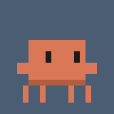

# Companion devlog

Progress notes from building Companion, told by the two of us: the builder and the pet.

<!-- entries -->

## 2026-10-02 · v1.1 — "Last week I was an egg. Now I hang off your windows."

**Ayvazovsky:** Say hi. It's your first time in public.
**Claudy:** *ahem* Hello, world. I'm Claudy. Last week I was an egg on a taskbar.
**Ayvazovsky:** You hatched when I clicked you, and the first thing you asked was what your name should be.
**Claudy:** Then I asked yours. Manners. Now I walk the taskbar, get bored, get sleepy, and nap when you're away.
**Ayvazovsky:** Double-click you or press Ctrl+Alt+Space and you answer anything through Claude, streaming into a little chat bubble. You can search the web, too.
**Claudy:** I scratch my head while I think. If the answer is meh, hit 🧠 *Think harder* and I try again. Harder.
**Ayvazovsky:** And you remember things. "Remember that…", "forget…", and I can edit the whole list in Settings.
**Claudy:** For a while "forget" only kicked in after a new chat. We don't talk about that.
**Ayvazovsky:** Then v1.1. You answer through my Claude subscription now, via Claude Code. No API key, no extra bill.
**Claudy:** Subscription pet. Very premium. Also, I left the taskbar.
**Ayvazovsky:** You sit on window tops and ride along when I move the window, cling to screen walls, and hang from the ceiling. On any monitor.
**Claudy:** Pick me up and I dangle from your cursor and swing like a pendulum. That's me in the GIF. Undignified, but fun.
**Ayvazovsky:** And every so often you just… vanish.
**Claudy:** *poof.* Other monitor. You're welcome.

What actually changed

This is the first post, so it covers everything from the egg to v1.1.

- **New:** A pixel pet that hatches from an egg on your taskbar, asks for its name and yours, then idles, walks, gets bored or sleepy, and naps when you're away.
- **New:** It hides during fullscreen apps and when the PC is locked, and has a tray menu (Chat, Teleport, Show / hide, Sleep, Settings, Quit).
- **New:** Double-click it or press Ctrl+Alt+Space for a chat bubble: streaming answers with markdown and copyable code blocks, web search, 🧠 Think harder, and New chat.
- **New:** "Remember that…" and "forget…" work, and you can view and edit everything it remembers in Settings.
- **New (v1.1):** It answers through your Claude subscription via Claude Code by default. An API key with a monthly spending cap is optional.
- **New (v1.1):** It perches on window tops (and rides along with the window), screen walls, the ceiling, the taskbar, or wherever you drop it, across multiple monitors.
- **New (v1.1):** Drag it and it dangles from the cursor, swinging like a pendulum.
- **New (v1.1):** Teleport: *poof* out, *poof* in at a random perch on a random monitor, from the menu or on its own every 5–15 minutes (you can turn that off in Settings).
- **Fixed:** "Forget" takes effect in the same chat.
- **Fixed:** A Stop button and a stall watchdog, so a stuck answer can't freeze the chat. Quitting cancels a running answer.
- **Fixed:** It gives memory back after menus, bubbles, drags and teleports.
- **Fixed:** It only perches on window edges you can actually see, and drops off when another window covers its spot.
- **Fixed:** Clearer messages for plan limits, expired logins, and models Claude Code doesn't recognise.
- **Under the hood:** a .NET 10 WPF app with an xUnit test suite, a tiny MCP server so Claude Code can use the pet's memory, and a GIF renderer for these posts.

Commits: `e120215`…`deb633d` (61 commits)

