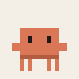

# Companion

A tiny pixel pet that lives on your Windows desktop and answers anything through Claude.



It hatches from an egg, lets you name it, wanders along your taskbar, naps when you're away, and climbs onto your windows. Double-click it to ask a question, and it thinks, then talks back in a little chat bubble.

## What it can do

- **Live on your desktop.** It idles, walks, gets bored, gets sleepy, and sleeps. It hides during fullscreen apps and when the PC is locked.
- **Perch anywhere.** Drag it and it dangles from your cursor like a pendulum. Drop it on the taskbar, on a window's top edge (it rides along with the window), on a screen wall, or on the ceiling. It works across multiple monitors.
- **Teleport.** *Poof*: it vanishes and turns up somewhere else, on request or on its own every so often.
- **Answer anything.** Answers stream in a chat bubble with markdown and copyable code blocks. It can search the web for current events, and a 🧠 *Think harder* button asks Claude again, more deeply.
- **Remember you.** "Remember that…" and "forget…" work, and you can view and edit everything it remembers in Settings.
- **Cost nothing extra.** By default it answers through your Claude subscription, via [Claude Code](https://claude.com/claude-code). An API key with a monthly spending cap is optional.
- **Stay light.** The target is under 60 MB of RAM and under 1% CPU when idle.

## Progress

Each update gets a devlog entry: the builder and the pet talking it over. Read the full story in **[DEVLOG.md](DEVLOG.md)**, or follow the [Releases](../../releases).

<!-- progress -->

## Run it

Requirements: Windows 10/11, the [.NET 10 Desktop Runtime](https://dotnet.microsoft.com/download/dotnet/10.0), and Claude Code installed and logged in (or an Anthropic API key).

- **From a release:** download the zip from [Releases](../../releases), unzip it anywhere, and run `app\Companion.exe`.
- **From source:** install the .NET 10 SDK, then run:

  ```powershell
  dotnet run --project src/Companion
  ```

  To build the portable app into `app\`, run `tools\publish.ps1`.

Your pet's memory, settings and logs stay in `data\`, next to the app. Nothing is stored anywhere else.

## Project layout

| Folder | What's in it |
|---|---|
| `src/Companion` | The WPF app: the pet window, chat bubble, settings and tray |
| `src/Companion.Core` | Pet life, movement planning, the Claude clients and memory (no UI) |
| `src/Companion.Memory` | A tiny MCP server that lets Claude Code use the pet's memory |
| `src/Companion.Tests` | xUnit tests |
| `skins/default` | The sprite sheet; replace it to reskin your pet |
| `tools` | Publish script, footprint check, sprite and GIF generators |
| `docs` | Design specs and implementation plans |

Built with [Claude Code](https://claude.com/claude-code).
